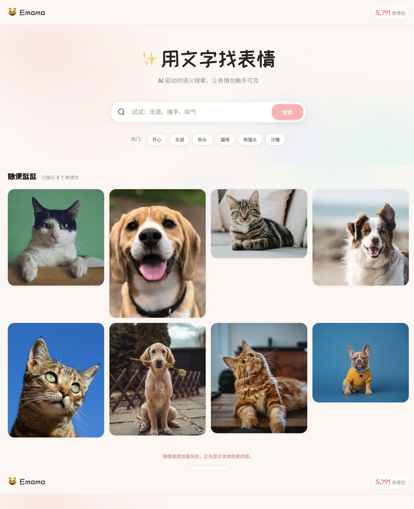
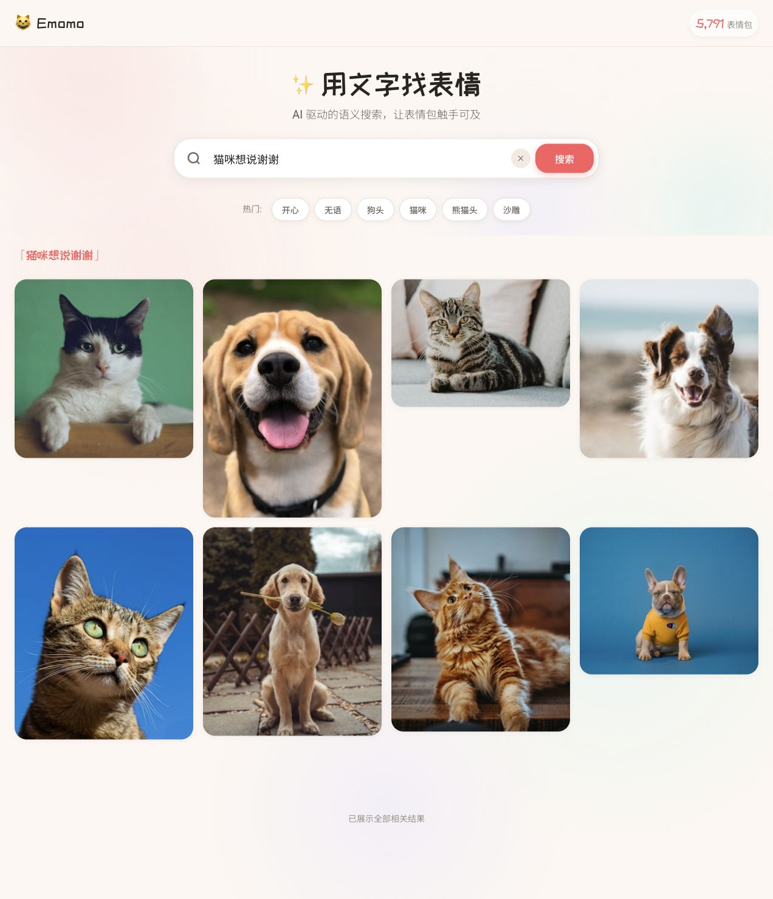
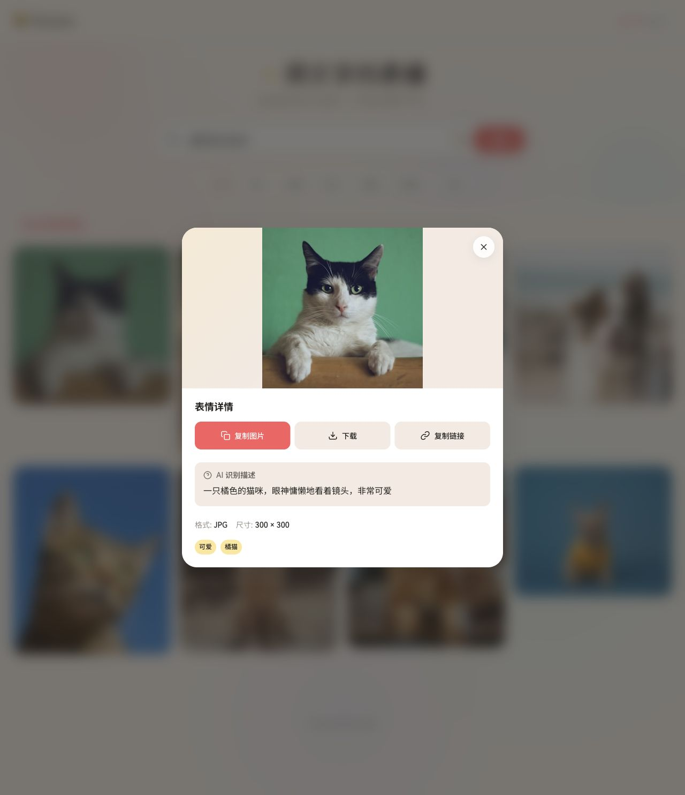

# emomo 旧 Web 产品说明（历史记录）

> 当前使用入口见 [README](../README.md) 和[正式版说明](PUBLIC_RELEASE.md)。原生 iOS / Android App 已于 2026-10-25 退役，详见[退役记录](MOBILE_RETIREMENT.md)。

## 历史验证

2026-06-09，提交 `ec86554`：旧 Web 本地运行与浏览器截图，保留于 [截图目录](assets/product-guide/ec86554/)。以下描述只反映当时的旧 Web 行为。

## 一句话介绍

emomo 是一个表情包搜索工具。你可以用自然语言描述情绪、场景或想表达的话，快速找到适合聊天使用的表情图。

## Web 端

### 首页

首页的主要作用是让用户直接开始搜索，也可以先随便浏览示例表情。

- 顶部 `Emomo`：点击后回到首页，清空当前搜索状态。
- 右上角表情包数量：展示当前表情库规模；当在线统计不可用时，会显示内置默认数量。
- 搜索框：输入你想找的表情，例如“猫咪想说谢谢”“无语”“狗头”。
- `搜索`：有输入内容时可点击；点击后开始查找表情。
- 输入框里的 `X`：清空当前输入。清空后回到随便逛逛状态。
- 热门标签：点击 `开心`、`无语`、`狗头`、`猫咪`、`熊猫头`、`沙雕` 会自动把标签填入搜索框并发起搜索。
- `随便逛逛`：展示可浏览的表情。在线内容加载失败时，会显示本地示例内容，并出现重试入口。
- `重试加载`：重新尝试加载随便逛逛内容。

### 搜索结果

搜索后页面会进入结果视图。

- 搜索框会保留本次搜索词，方便继续修改。
- 搜索词标题会以 `「搜索词」` 的形式显示，帮助用户确认当前结果来自哪次搜索。
- 图片网格展示匹配到的表情。点击任意图片会打开详情弹窗。
- 鼠标移到图片上时，会出现两个快捷按钮：
  - `复制表情链接`：把该表情图片链接复制到剪贴板。
  - `下载表情`：下载该表情图片。
- 如果匹配度偏低，页面会提示当前结果更像相近情绪或相近语境，提醒用户可以换一种描述。
- 结果展示完后会显示 `已展示全部相关结果`。

### 搜索进度与取消

当在线搜索正常进入处理流程时，页面会展示阶段进度：

- `理解意图`：理解用户想找什么。
- `生成向量`：把搜索描述转换成可匹配的语义信息。
- `搜索`：在表情库里查找相近结果。
- `加载`：整理并显示结果。
- `取消`：中止当前搜索，页面停止等待结果。

如果在线搜索不可用，页面会退回本地示例结果，让用户仍然可以浏览、打开详情、复制或下载。

### 表情详情

点击图片后会打开 `表情详情`。

- 大图：展示当前表情。
- `X` / 点击弹窗外部 / 按 `Esc`：关闭详情，回到列表。
- `复制图片`：优先复制图片本身，成功后按钮会变成 `已复制`。
- `下载`：下载当前图片，成功后按钮会短暂显示 `已下载`。
- `复制链接`：复制当前图片链接，适合粘贴到不支持图片剪贴板的地方。
- `AI 识别描述`：用一句话解释图片内容，帮助用户判断是否适合当前聊天场景。
- `格式`、`尺寸`：展示图片文件信息。
- 标签：展示图片相关标签，例如可爱、橘猫等。

复制成功状态如下：

### 窄屏布局

在手机宽度的浏览器里，页面会自动变成窄屏布局：

- 搜索框和按钮上下排列，更适合单手操作。
- 热门标签自动换行。
- 表情网格变成两列。
- 加载失败、重试等状态会显示在页面底部。

## 历史记录范围

本文仅保留 2026-06-09 的旧 Web 界面和截图，不能作为当前线上产品的验收证据。原生 App 已退役，运行和上架说明已移除；历史 App 记录可在退役前提交中查看。
