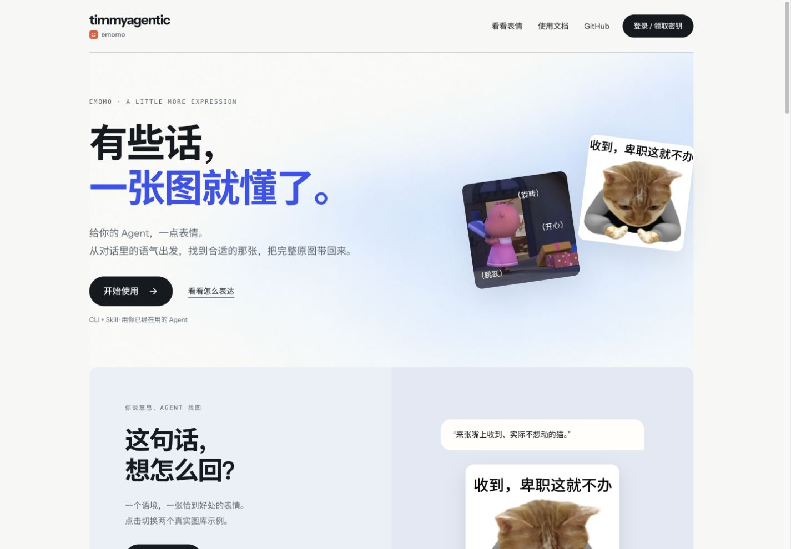

# Website polish QA — 2026-10-25

The homepage and docs have a share image. Installation copy works in both side-by-side and stacked layouts. The account Worker and its configuration are unchanged.

Validated in a local browser at 1440 × 1000 and 390 × 844; the page also has no horizontal overflow at 320 px. Visible images loaded. Social metadata resolves to a 1200 × 630 image. Screenshots below are unmodified browser captures of the candidate.

Checks passed: `node scripts/dev.mjs check agent` (CLI, API/image services and website checks).

This is website acceptance. Live installation, authentication, production hardware/network operations, and native client acceptance are outside this change. A successful local check does not prove production deployment; the reviewed commit must be deployed and read back separately.

